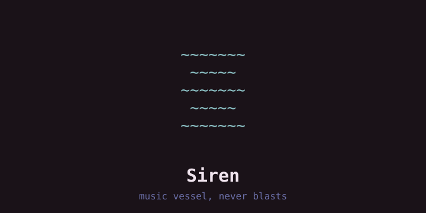
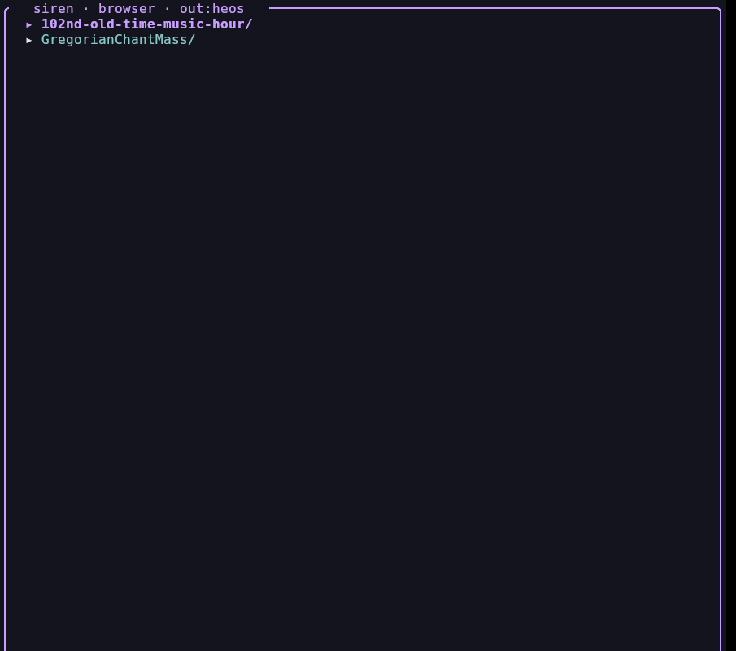
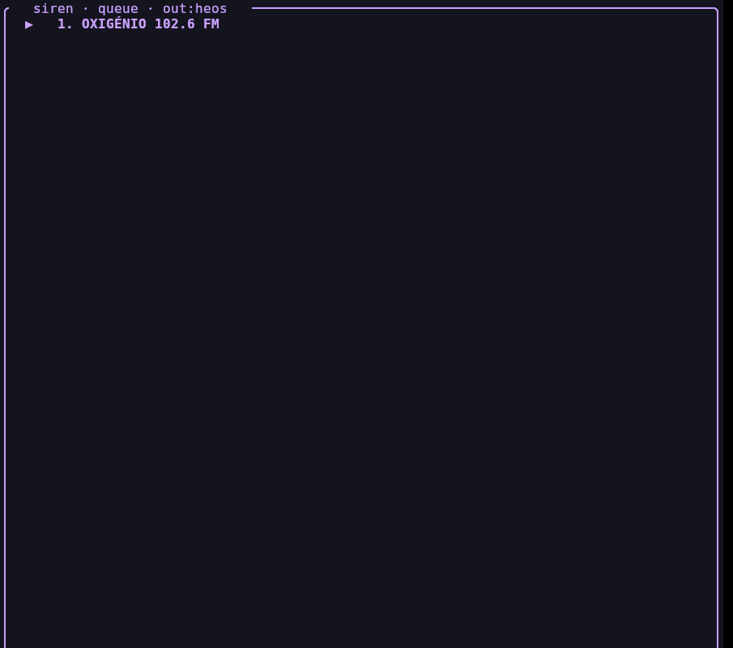

# Siren — the music 🎵

```
~~~~~~~
 ~~~~~ 
~~~~~~~
 ~~~~~ 
~~~~~~~
```

A terminal music player. Local files through **mpv**, a two-box TUI,
optional HEOS speakers on the same LAN. Linux, Windows, and macOS.

**Status:** 0.1.1 — looking for testers. Hard dependency: **mpv** on
PATH. Downloads (linux + windows):
[Grove](https://elegantvw.github.io/grove/#app-siren) /
[Releases](https://github.com/ElegantVW/siren/releases).
Port notes and the smoke list: [`docs/PORT.md`](docs/PORT.md).
House follow / Cave wiring: [`docs/AUDIO.md`](docs/AUDIO.md).

For: flac/mp3/ogg in `~/Music` (Windows: `%USERPROFILE%\Music`), radio,
a HEOS box on your LAN. Not for: Spotify apps, Bluetooth as a Siren
path.

## Looking for testers

We want reports from **Linux** (Debian, Q4OS, others), **Windows 10/11**,
and **macOS**. Open a [GitHub issue](https://github.com/ElegantVW/siren/issues)
with the smoke list in [`docs/PORT.md`](docs/PORT.md), or email
evenweaker@disroot.org with subject `[siren test]`. OS, terminal, mpv
version, file type, what you heard, what broke.

## Look




```
~~~~~~~
 ~~~~~ 
~~~~~~~
 ~~~~~ 
~~~~~~~
```

## Layout

- `src/` — rust engine (`cargo build --release`)
- `scripts/siren` — thin unix launcher (never a prebuilt ELF in git)
- `./build.sh install` — ELF → `~/.local/bin/siren`
- `./build.sh install --house` — faeOS engine path + follow unit

## TUI

Two boxes + a waves strip on every view except viz. Top = content
view (Tab cycles browser → queue → audio → mixer → trove → radio → viz).
Bottom = context menu of the focused view. The strip shows speaker
state + 3-row spectrum; the viz tab *is* that spectrum (full canvas,
no second box). Press `h` for help overlay (matches the handlers;
any key closes it).

**Global keys** (every view; these fire first):

| Key | Action |
|-----|--------|
| Tab / Shift-Tab | cycle views (`cycle_next` / `cycle_previous` in Grove's canonical keyboard catalog) |
| `n` / `b` | next / previous |
| `p` | pause / resume |
| ← / → | seek ±5s (Shift ±30s) |
| `+` / `-` | volume (HEOS while following) |
| `T` | cycle palette (pixie blush silver siren cave) |
| `h` | help overlay |
| `q` | quit |
| Esc | quit (closes a picker first) |

The generated binding adapter is `src/grove_keys.rs`; regenerate from Grove
with `python3 ../faeOS/tools/sync-keyboard-shortcuts.py` and verify with
`--check`.

**View keys** (uppercase = variant):

| View | Keys |
|------|------|
| browser | Enter/space play · `a` add · `c` cast · ⌫ up · `/` filter · `S` save · `L` load · `R` rm |
| queue | Enter play-from · `d` remove · `C` clear · `s` shuffle |
| audio | `o` local/heos · `S` speaker · `W` follow · mixer `j`/`k`/`m` · `g`/`u`/`G` group · `,`/`.` group vol |
| mixer | drag fader · click wave mute · `j`/`k`/`←`/`→` select · `+/-` selected · `m` mute |
| trove | `s` search · Enter version · `D` download · `M` more · `A` all · `F` format |
| radio | Enter/space play · `C` country · `s` search · `f` fav · `A` URL · `M` more |
| viz | Tab cycles (pane pushes) |

**Group control** (audio view): `g` groups all speakers under current
speaker as leader, `u` ungroups, `G` toggles group mute, `,`/`.` adjust
group volume. HEOS natively syncs grouped speakers — verified 1–2ms
drift.

**Mixer** (mixer tab): vertical faders for the current speaker, analog
phones (and other Pulse sinks), plus live apps. Drag the bar, click
the wave glyph to mute, wheel to nudge. On this tab `+/-` is the
selected fader and unshifted `←`/`→` pick a channel. Windows Pulse
columns skip; the speaker fader still works.

**Radio honesty**: favorites play their own saved URL first (direct
`play_stream`), TuneIn only as fallback. Playback is verified by
polling speaker state — dead streams report failure instead of fake
success. HTTP URLs are pre-checked with HEAD, then GET when HEAD is
400/405 (Icecast); 404 stays dead. HTTPS passes through (no TLS in std).

**Loading cue**: play runs in a job thread so the TUI never freezes.
While it runs, the bottom status line shows `| connecting… <name>`
with an animated `|/-\` spinner. The waves strip is reserved for the
visualizer and is never used for status.

**Visualizer** (`V` view, last Tab stop): live spectrum. Walks analog
→ Master → HEOS HTTP until one has audio (one reader). 60fps while
animating. Braille rendering (2×4 dots
per cell). Horizontal only. Tab / Shift-Tab push the top pane.
Peak-hold caps fall slowly. Other views keep a compact horizontal
strip; the viz tab is the full canvas (no second box).

**Follow** (audio view `W`, or `siren audio follow on|off`): Cave plays
Siren music. Headset (front combo jack) stays the PipeWire default for
calls and everything except that music. Follow pins mpv to
`Siren_Master`; the encoder captures `Siren_Master.monitor`, serves
WAV/L16 on `:8899/siren.wav`, UPnP to Cave. `follow off` unpins mpv and
leaves the headset default. Login unit `siren-follow.service` runs
`follow run` (stays up with the encoder). `now` labels follow as **Siren Follow** (UPnP, not CLI)
`unknown`). Seek is skipped on the live wav. Volume keys move HEOS
group volume. Queue `s` shuffles. `p` / ← → are global pause and seek.

`output local` is how radio rides follow. `output heos` is Cave fetching
TuneIn or DLNA itself (needs WAN).

## Audio

Siren owns its audio routing (`~/.config/siren/config.json`):

**Group mode:** `g` in audio view groups all HEOS speakers.
HEOS handles sync natively. Verified: 1–2ms drift between speakers.

```
siren audio                  # output, speaker, volumes, DLNA status
siren audio probe            # LAN doctor: cached IPs vs /24 :1255
siren audio follow on        # mpv → Siren_Master → Cave; headset stays analog
siren audio vol +10          # HEOS group volume while following
siren seek +5                # skip live wav; files only
siren audio output heos      # Cave fetches the URL (needs WAN)
siren audio output local     # mpv; radio rides follow
siren cast <query>           # top library match → current speaker (DLNA)
siren audio queue              # speaker queue: qid · song — artist
siren audio queue play 2       # play / rm / clear / move 1 3
siren cast QUERY --next        # queue play-next (aid=2)
siren cast QUERY --append      # add to end (aid=3)
siren queue add QUERY          # local queue persists (~/.config/siren/queue.json)
```

Default speaker while Office is off this LAN: **Cave**. Roster lives in
`~/.cache/siren/heos-roster.json` — identity is name/pid, not a cached
IP. `siren audio probe` is the doctor when a box goes missing.
Protocol: HEOS CLI on TCP/1255 (newline `heos://` URIs) +
`VANGUARDA-DLNA` (minidlna on `:8200`); queue via `add_to_queue aid=1`
with raw `$` in cid/mid.

## Trove

Free & legal music (Internet Archive + ccMixter), zero new Rust deps (system `curl`):

```
siren trove music lofi      # 20, then [m] more (infinite scroll)
siren trove live grateful   # Live Music Archive (etree)
siren trove ccmixter lofi   # ccMixter remixes (needs Referer, handled)
siren trove get <identifier>
siren trove about
```

TUI: 5th Tab stop (`trove`), `s` search · Enter pick version · `D`
download cursor · `j/k` + auto-prefetch near the end · `M` more · `A`
all (double-press) · `F` session format · mouse wheel + click select,
double-click acts. Search, metadata and downloads run in background
threads.

## Radio

Community stations (radio-browser.info, keyless), same output channel
as music — local mpv or speaker `play_stream`:

```
siren radio countries         list countries (a-z)
siren radio stations Portugal stations for a country
siren radio search lofi       search by name
siren radio play <words>      play top match
siren radio fav               list favorites
siren radio fav <words>       toggle favorite
```

TUI: 6th Tab stop (`radio`). `Enter` with no country opens the country
picker (a-z, cached a week); `Enter`/space plays the cursor row, `C`
re-picks country, `s` searches, `f` toggles favorite (★ pinned on top),
`A` favorites any stream URL, `M` more. Favorites + last country persist
in `~/.config/siren/radio.json`. Streams ride the queue as URL items
(station name as label). Speaker radio rides TuneIn (no login): raw-URL
`play_stream` won't hold on this unit (verified dead 5 ways), but
`browse/play_stream` with a TuneIn `mid` sustains — output maps the
station name to TuneIn live. Local radio is plain mpv.
Guards: `.part` resume, skip-if-exists, 40-file cap, 32MB confirm,
`TROVE_MAX_TOTAL`. Lands in `~/Music/trove/<identifier>`.

## Build

```bash
./build.sh                 # cargo build --release
./build.sh install         # ELF → ~/.local/bin/siren
./build.sh install --house # faeOS engine + follow unit
```

Needs a Rust toolchain and **mpv**. See [`docs/PORT.md`](docs/PORT.md)
for Windows / Q4OS / macOS.

**Tests:** `cargo test --offline`. Helpers (path shape, JSON, IPC cfg)
over live LAN. `#[ignore]` only for boxes that must be on the wire.
